**Product manager who designs. Designer who measures. Based in New York.**

[Now](#now) &nbsp;·&nbsp; [Path](#path) &nbsp;·&nbsp; [Toolkit](#toolkit) &nbsp;·&nbsp; [Pick a door](#pick-a-door) &nbsp;·&nbsp; [Say hi](#say-hi)

## Now

I'm a **Senior Product Manager at [Curebase](https://www.curebase.com)**, building technology for decentralized clinical trials. My work sits across ePRO, eConsent, and EDC workflows, product analytics, and AI-native product development.

I move between Figma and the roadmap without changing hats. Most of my career has been spent making complicated healthcare software feel simple, then proving it with data.

## Path

Tap a role to open it.

<b>Curebase</b> &nbsp;·&nbsp; Senior Product Manager

 

- Product for decentralized clinical trials: ePRO, eConsent, EDC
- Analytics instrumentation and AI-native product workflows

<b>Ambry Genetics, a Tempus AI company</b> &nbsp;·&nbsp; Product Manager

 

- Led clinical genomics portals integrated with EMR/EHR systems
- Used NCCN clinical guidelines to identify patients at hereditary cancer risk
- Set up design systems spanning six products
- Drove 10 to 45% improvements in user flow completion rates
- Built analytics instrumentation that uncovered conversion bottlenecks

<b>Latice Design Agency</b> &nbsp;·&nbsp; Founder

 

- Design agency serving enterprise clients, including HP, Unilever, the Gates Foundation, and Ogilvy
- Now runs as a design consultancy at [shiv.nyc](https://shiv.nyc)

## Toolkit

| Area | What I reach for |
| :-- | :-- |
| Product | Strategy, roadmaps, specs, discovery |
| Design | Design systems, Figma, Untitled UI, UI/UX |
| Analytics | Mixpanel, Tableau, instrumentation, analytics storytelling |
| Domain | Healthcare SaaS, clinical trials, ePRO, eConsent, EDC, EMR/EHR |
| AI | AI-native product development, agentic workflows, automation |

## Pick a door

Three doors. Open whichever one brought you here.

🚪 <b>Door 1:</b> I need a product person

 

Good door. I turn messy clinical and operational workflows into products people finish using. I write the spec, instrument the funnel, and stay until the numbers move.

Quick quiz: how much can fixing a user flow move completion?

A. About 2%

 
Too modest. Try again.

B. 10 to 45%

 
Correct. That is the range I delivered across flows at Ambry Genetics.

C. It can't be measured

 
Everything can be measured. That is what the instrumentation is for.

🚪 <b>Door 2:</b> I need a designer

 

Also a good door. I founded Latice Design Agency and have built design systems that hold up across six products at once. I care about clean systems, brand consistency, and high-fidelity output.

See the work at [shiv.nyc](https://shiv.nyc) and [latice.design](https://latice.design).

🚪 <b>Door 3:</b> I'm just hungry

 

The best door. I built [How To Masala](https://howtomasala.com), which gives you an AI-personalized 12-week spice curriculum. Start there and report back.

## Say hi

[shiv.nyc](https://shiv.nyc) &nbsp;·&nbsp; [latice.design](https://latice.design) &nbsp;·&nbsp; [info@latice.design](mailto:info@latice.design)

Mumbai, Milan, New York. The banner above is a hand-written animated SVG, no scripts.

